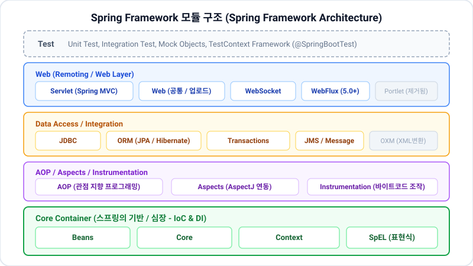
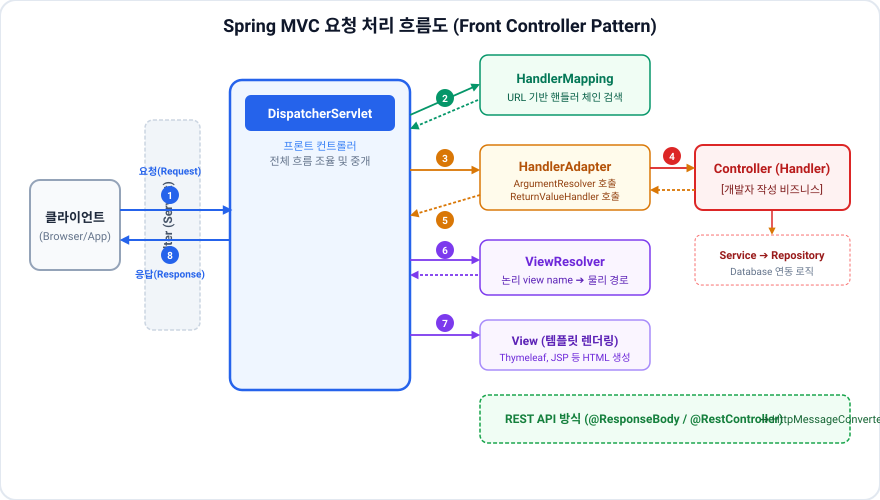

# 스프링 아키텍처 정리

## 목차

1. Spring Framework 모듈 구조
2. Spring MVC 요청 처리 흐름
3. 모듈과 요청 흐름의 연결
4. 요약

---

## 1. Spring Framework 모듈 구조



### 1.1 개념

스프링은 하나의 거대한 라이브러리가 아니라 **기능별로 나뉜 여러 모듈의 집합**입니다.
필요한 모듈만 골라 쓸 수 있도록 설계되어 있고, 모든 모듈은 **Core Container를 기반**으로 그 위에 쌓여 있습니다.

- **아래층**: 객체를 만들고 관리하는 기반 (Core Container)
- **중간층**: 공통 기능을 끼워 넣는 기술 (AOP)
- **위층**: 실제 서비스 기능 (데이터 접근, 웹)
- **전체를 가로지르는 것**: 테스트 지원 (Test)

스프링 부트의 `spring-boot-starter-web`, `spring-boot-starter-data-jpa` 같은 스타터는 이 모듈들을 용도별로 묶어 둔 것입니다.

### 1.2 Core Container

스프링의 심장입니다. 다른 모든 모듈이 이 위에서 동작합니다.

| 모듈 | 역할 |
|---|---|
| Beans | 빈(Bean)의 생성, 의존성 주입(DI) |
| Core | 스프링 전반에서 쓰는 기본 유틸리티 |
| Context | `ApplicationContext`(스프링 컨테이너) 제공, 이벤트·국제화 등 부가 기능 |
| Expression Language (SpEL) | 런타임에 객체 그래프를 조회하고 조작하는 표현식 (`@Value("#{systemProperties['user.timezone']}")`, `@Value("#{authService.tokenValidity * 2}")`) |

> [!NOTE]
> `@Value("${jwt.secret}")`의 `${...}`는 SpEL이 아니라 **프로퍼티 플레이스홀더(Property Placeholder)** 문법입니다. SpEL은 `#{...}` 기호를 사용하여 런타임 객체 탐색 및 연산을 수행합니다.

**IoC (Inversion of Control, 제어의 역전)**
- 객체를 생성하고 연결하는 제어권이 개발자가 아니라 스프링 컨테이너에 있다는 뜻입니다.
- 개발자는 `new`로 객체를 만들지 않고, 어떤 객체가 필요한지만 선언합니다.

**DI (Dependency Injection, 의존성 주입)**
- IoC를 구현하는 방법입니다. 컨테이너가 필요한 빈을 생성자 등을 통해 주입해 줍니다.

```java
@Service
@RequiredArgsConstructor
public class AuthService {
    private final UserRepository userRepository; // 컨테이너가 주입
}
```

**빈(Bean)**
- 스프링 컨테이너가 생성하고 관리하는 객체입니다.
- 기본적으로 애플리케이션 전체에서 하나만 만들어지는 싱글톤입니다.
- `@Component`, `@Service`, `@Repository`, `@Controller`를 붙이거나, `@Configuration` 클래스에서 `@Bean`으로 등록합니다.

### 1.3 AOP / Aspects / Instrumentation

| 모듈 | 역할 |
|---|---|
| AOP | 관점 지향 프로그래밍 지원 |
| Aspects | AspectJ 연동 |
| Instrumentation | 클래스 로딩 시점에 바이트코드를 조작하는 저수준 기능 |

**AOP (Aspect Oriented Programming, 관점 지향 프로그래밍)**
- 로깅, 트랜잭션, 보안 검사처럼 **여러 클래스에 반복해서 필요한 기능(횡단 관심사)**을 핵심 로직과 분리하는 기법입니다.
- 스프링은 대상 객체를 감싸는 **프록시(Proxy)**를 만들어 메서드 호출 앞뒤에 공통 기능을 끼워 넣습니다.

**대표 사례: `@Transactional`**

```
호출 → [프록시] 트랜잭션 시작 → 실제 메서드 실행 → 커밋 또는 롤백 → 반환
```

> [!WARNING]
> 같은 클래스 안에서 메서드끼리 호출하면 프록시를 거치지 않아 `@Transactional`이 적용되지 않습니다(Self-invocation 문제).

### 1.4 Data Access / Integration

데이터베이스와 외부 시스템 연동을 담당합니다.

| 모듈 | 역할 |
|---|---|
| JDBC | DB 연결의 기본. 반복되는 연결·종료 코드를 `JdbcTemplate`로 줄여 줌 |
| ORM | JPA, Hibernate 같은 ORM 기술 연동 |
| Transactions | 선언적 트랜잭션(`@Transactional`) 지원 |
| OXM | 객체 ↔ XML 변환 (현재는 거의 쓰지 않음) |
| JMS | 메시지 큐 연동 (현재는 Kafka, RabbitMQ 연동이 더 흔함) |

**ORM (Object Relational Mapping)**
- 자바 객체와 DB 테이블을 자동으로 매핑해 주는 기술입니다.
- SQL을 직접 쓰지 않고 객체를 다루듯 데이터를 저장·조회할 수 있습니다.

**JPA와 Hibernate의 관계**
- **JPA**: 자바 ORM의 **표준 명세**(인터페이스)
- **Hibernate**: JPA를 **실제로 구현한 라이브러리**
- **Spring Data JPA**: JPA를 더 쉽게 쓰도록 `JpaRepository`를 제공하는 스프링 모듈

```
Spring Data JPA → JPA(표준) → Hibernate(구현체) → JDBC → Database
```

### 1.5 Web (MVC / Remoting)

웹 요청 처리를 담당합니다.

| 모듈 | 역할 |
|---|---|
| Web | 멀티파트 업로드, HTTP 클라이언트 등 웹 공통 기능 |
| Servlet | Spring MVC. `DispatcherServlet` 기반 요청 처리 |
| Portlet | 포털 환경 지원 (Spring 5에서 제거) |
| Struts | Struts 프레임워크 연동 (Spring 4에서 제거) |

### 1.6 Test

- 스프링 컨테이너를 띄운 상태로 테스트를 실행하는 기능을 제공합니다.
- `@SpringBootTest`(통합 테스트), `@WebMvcTest`(컨트롤러만), `@DataJpaTest`(JPA만) 등이 있습니다.
- Mock 객체를 빈 대신 주입해 특정 계층만 독립적으로 검증할 수 있습니다.

### 1.7 버전에 따른 변화

| 구분 | 내용 |
|---|---|
| 추가됨 | `WebFlux`(비동기·논블로킹 웹), `spring-jcl` 등 |
| 제거됨 | `Portlet`, `Struts` 연동 |
| 변경됨 | Spring 6부터 `javax.*` → `jakarta.*` 패키지 전환, Java 17 이상 필요 |
| 유지됨 | Core Container 위에 나머지 모듈이 얹힌 큰 아키텍처 구조 |

---

## 2. Spring MVC 요청 처리 흐름



### 2.1 개념

**MVC 패턴**은 애플리케이션을 세 역할로 나누는 설계 방식입니다.

| 구성 | 역할 |
|---|---|
| Model | 화면에 전달할 데이터 |
| View | 사용자에게 보여지는 화면 |
| Controller | 요청을 받아 로직을 호출하고, Model과 View를 연결 |

Spring MVC는 이 패턴을 **Front Controller 패턴**으로 구현합니다.
모든 요청을 `DispatcherServlet` 하나가 먼저 받고, 적절한 담당자에게 나눠 주는 방식입니다.
덕분에 공통 로직(인코딩, 인증, 예외 처리 등)을 일관되게 중앙 관리할 수 있습니다.

### 2.2 단계별 흐름

| 단계 | 구성 요소 | 하는 일 |
|---|---|---|
| ① | Request | 클라이언트 요청이 Filter를 거쳐 `DispatcherServlet`으로 들어옴 |
| ② | Handler Mapping | 요청 URL·메서드를 기반으로 처리할 컨트롤러와 인터셉터 목록(`HandlerExecutionChain`)을 찾음 |
| ③ | Handler Adapter | 찾은 컨트롤러를 호출할 수 있는 어댑터를 선택 |
| ④ | Controller 실행 | ArgumentResolver가 파라미터를 바인딩한 후 컨트롤러 실행 (Service ➔ DB 연동) |
| ⑤ | view name 반환 | 컨트롤러 처리 결과(Model)와 논리적 뷰 이름을 어댑터에 반환 |
| ⑥ | View Resolver | 논리적 뷰 이름을 실제 뷰 템플릿 파일 경로로 변환 |
| ⑦ | View 렌더링 | View가 Model 데이터를 참조해 최종 HTML을 렌더링 |
| ⑧ | Response | 완성된 응답이 Interceptor, Filter를 거쳐 클라이언트로 전달됨 |

### 2.3 구성 요소 상세

**DispatcherServlet**
- Spring MVC의 진입점이자 중앙 관리자(Front Controller)입니다.
- 직접 로직을 처리하지 않고, 각 단계를 담당하는 컴포넌트를 순서대로 호출하며 전체 흐름을 조율합니다.

**Handler Mapping**
- "이 요청을 어느 컨트롤러가 처리할 것인가?"를 결정합니다.
- 컨트롤러뿐 아니라 요청 전후에 실행될 인터셉터 목록을 포함한 **`HandlerExecutionChain`** 형태로 반환합니다.

**Handler Adapter**
- 컨트롤러 형태가 제각각이어도 `DispatcherServlet`이 통일된 규격으로 호출할 수 있게 맞춰 줍니다.
- **`ArgumentResolver`**: 호출 전 요청 데이터를 컨트롤러 파라미터 타입으로 변환 (`@RequestBody`, `@PathVariable` 등)
- **`ReturnValueHandler`**: 컨트롤러의 반환값을 알맞은 응답 형태로 가공 처리

**Controller (Handler)**
- 개발자가 실제 비즈니스 요청을 받아 Service 계층을 호출하고 결과를 반환하는 계층입니다.

**View Resolver & View**
- **View Resolver**: 논리적 화면 이름을 실제 템플릿 경로(예: `"login"` → `templates/login.html`)로 변환합니다.
- **View**: Model 데이터를 채워 최종 HTML을 생성하는 템플릿(Thymeleaf 등)입니다.

### 2.4 역할 구분

| 구분 | 해당 요소 |
|---|---|
| 개발자가 직접 구현 | Controller, Service, Repository, (반환할 논리적 view name) |
| 스프링이 제공 | DispatcherServlet, Handler Mapping, Handler Adapter, View Resolver, Model |
| 스프링 제공 + 직접 커스텀 | View (템플릿 작성), Interceptor, Filter |

### 2.5 REST API 방식 (`@RestController`)

React/Vue처럼 프론트엔드가 분리된 구조에서는 서버가 HTML을 반환하지 않고 **JSON 데이터**만 응답합니다.
이 경우 View Resolver와 View 단계가 생략됩니다.

```
[서버 사이드 렌더링 (SSR)]
④ Controller → ⑤ view name → ⑥ View Resolver → ⑦ View(HTML) → ⑧ Response

[REST API (@RestController)]
④ Controller → ReturnValueHandler → HttpMessageConverter(JSON 변환) → ⑧ Response
```

- `@RestController` = `@Controller` + `@ResponseBody`
- **`ReturnValueHandler`**가 동작하여 **`HttpMessageConverter`**(내부 Jackson)를 통해 HTTP 응답 바디(Output Stream)에 직접 JSON을 씁니다.
- 뷰 렌더링 단계가 건너뛰어지므로 불필요한 HTML 생성 오버헤드가 없습니다.

### 2.6 흐름 중간에 끼어드는 요소 (전체 Lifecycle)

요청 처리 전후와 예외 발생 시 공통 기능을 끼워 넣을 수 있는 지점입니다.

```
[요청] 클라이언트 ➔ Filter ➔ DispatcherServlet ➔ Interceptor (preHandle) ➔ Controller
                                                                            ↓ (Service/DB)
[응답] 클라이언트 ⬅ Filter ⬅ DispatcherServlet ⬅ Interceptor (afterCompletion) ⬅ ┘
                                                      ↓ 예외 발생 시
                                          @RestControllerAdvice ➔ 에러 JSON 응답
```

- **Filter**: 서블릿 컨테이너 레벨 동작. 인코딩, 보안(Spring Security), CORS
- **Interceptor**: 스프링 MVC 내부 동작. 인증/인가 체크, 로깅, 실행 시간 측정
- **`@RestControllerAdvice`**: 컨트롤러 전역에서 발생하는 예외를 감지해 일관된 JSON 에러 응답 반환

---

## 3. 모듈과 요청 흐름의 연결

요청 처리 흐름의 각 요소는 모듈 구조의 특정 영역에 속합니다.

| 요청 흐름의 요소 | 속한 모듈 | 설명 |
|---|---|---|
| DispatcherServlet, Handler Mapping, Handler Adapter, View Resolver | Web (Servlet) | 요청 수신과 분배 |
| Controller, Service, Repository 빈 관리 | Core Container | 객체 생성과 의존성 주입 |
| `@Transactional` 적용 | AOP, Transactions | 프록시를 통한 트랜잭션 경계 설정 |
| Repository ➔ Database | Data Access (ORM, JDBC) | JPA·Hibernate를 통한 DB 쿼리 실행 |
| 계층별 단위/통합 테스트 | Test | `@WebMvcTest`, `@DataJpaTest` |

---

## 4. 요약

1. 스프링은 **Core Container(Beans, Core, Context, SpEL)**를 기반으로 AOP, Data Access, Web 모듈이 얹힌 구조다.
2. Core Container는 **IoC/DI**를 통해 객체(빈)의 생명주기를 관리한다.
3. AOP는 **프록시(Proxy)**를 활용해 트랜잭션(`@Transactional`) 같은 횡단 관심사를 비즈니스 로직과 분리한다.
4. 웹 요청은 **DispatcherServlet**이 받아 Handler Mapping ➔ Handler Adapter ➔ Controller 순으로 위임한다(Front Controller 패턴).
5. 개발자는 **Controller, Service, Repository**만 작성하고, 나머지 라우팅과 인프라 흐름은 스프링이 전담한다.
6. REST API(`@RestController`)는 **HttpMessageConverter가 JSON을 직접 응답 바디에 작성**하므로 View 단계를 거치지 않는다.
